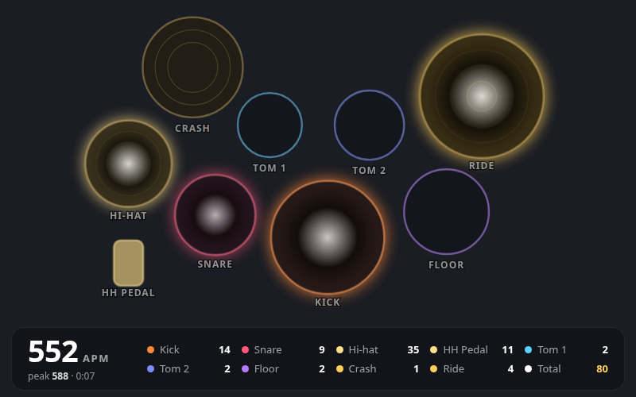

# drum-viz

A live e-drum kit overlay for OBS. Each pad lights up when you hit it, brighter the harder you hit. A strip along the bottom shows your APM (hits per minute) and how many times you've hit each piece this session.



Built for the Alesis Nitro Max. Any kit that sends General MIDI drum notes over USB should work.

## How it works

```
e-drum kit --USB MIDI--> ALSA sequencer --aseqdump--> server.py --SSE--> index.html (OBS Browser Source)
```

- `server.py` is a small bridge with no dependencies (Python stdlib only). It finds the kit's MIDI port, reads hits through `aseqdump`, and streams them to the page as Server-Sent Events. It shares the port, so it runs alongside Hydrogen or a DAW. It waits for the kit if the kit isn't plugged in, and reconnects if the kit is unplugged.
- `index.html` draws a top-down drum kit as SVG on a transparent background.

Linux only, because it uses the ALSA sequencer. You need `aseqdump` and `stdbuf`, which come with `alsa-utils` and `coreutils`.

## Setup

```sh
git clone https://github.com/Antimatter543/drum-viz ~/Projects/drum-viz
cd ~/Projects/drum-viz
python3 server.py            # serves http://127.0.0.1:7870
```

To run it in the background and start it at login:

```sh
cp drum-viz.service ~/.config/systemd/user/
systemctl --user enable --now drum-viz
```

The unit file assumes the repo lives at `~/Projects/drum-viz`. If yours is somewhere else, edit the `ExecStart` line.

### OBS

Add a **Browser Source** with these settings:
- URL: `http://127.0.0.1:7870/`
- Width / height: `800` × `500`
- Leave the custom CSS empty. The background is already transparent.

## Options

URL query parameters:

| Param | Effect |
|---|---|
| `?demo=1` | Plays a looping beat, so you can preview without the kit |
| `?labels=0` | Hides the piece labels |
| `?status=0` | Hides the "waiting for drum kit…" line |
| `?fade=400` | Sets the fade-out time in ms (default 280) |
| `?stats=0` | Hides the stats strip, so the kit fills the whole source |
| `?window=10` | Sets the APM averaging window in seconds (default 5) |

The stats session starts at your first hit. To reset it, refresh the browser source in OBS (right-click → Refresh).

Environment variables for `server.py`:

| Var | Default | Meaning |
|---|---|---|
| `DRUM_VIZ_PORT` | `7870` | HTTP port |
| `DRUM_PORT_MATCH` | `nitro\|alesis` | Regex matched against ALSA MIDI client and port names |

## Note map

These are the Nitro Max defaults, which mostly match the GM drum map. To change them, edit `NOTES` in `index.html`. Notes that aren't in the map are logged to the browser console. You can read those from OBS's browser-source dev tools, or open the page in a normal browser.

| Piece | Notes |
|---|---|
| Kick | 35, 36 |
| Snare (head / rim) | 38 / 37, 40 |
| Tom 1 / 2 / Floor | 48 / 45 / 43 (rims 50 / 47 / 58) |
| Hi-hat closed / half-open / open | 42 / 23 / 46 (edges 22 / 26) |
| Hi-hat pedal / foot splash | 44 / 21 |
| Crash | 49, 55, 57, 52 |
| Ride (bow / edge / bell) | 51 / 59 / 53 |

## License

MIT
